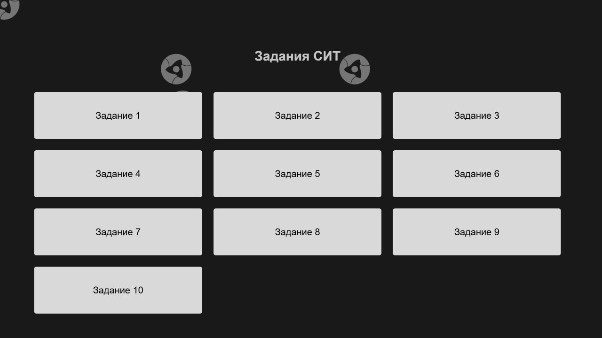

# КОНСИСТ ОС · Тестовое задание

Десять интерактивных задач на **HTML, CSS и JavaScript**.

[Открыть демо](https://xtrasupra.github.io/consist-os-test-assignment/) · [Исходный код](https://github.com/xtrasupra/consist-os-test-assignment)

## Контекст

Моя архивная работа, выполненная как техническое задание при трудоустройстве в **КОНСИСТ ОС**. Набор небольших интерактивных страниц показывает работу с алгоритмами, пользовательским вводом и выводом результата на JavaScript. Проект сохраняет самостоятельную ценность как пример ранней практики веб-разработки.

## Задания

| № | Тема |
|---|---|
| 1 | [Неуникальные элементы](pages/pages_1.html) |
| 2 | [Переворачивание слов в строке](pages/pages_2.html) |
| 3 | [Нахождение числа Фибоначчи](pages/pages_3.html) |
| 4 | [Сортировка списка по частоте элементов](pages/pages_4.html) |
| 5 | [Поиск ближайшего числа](pages/pages_5.html) |
| 6 | [Сортировка списка с сохранением нулей](pages/pages_6.html) |
| 7 | [Поиск элемента в отсортированном списке](pages/pages_7.html) |
| 8 | [Решение квадратного уравнения](pages/pages_8.html) |
| 9 | [Проверка правильности расставленных скобок](pages/pages_9.html) |
| 10 | [Нахождение факториала](pages/pages_10.html) |

## Что исправлено при публикации

Сетка и формы переведены в обычный поток документа, декоративный фон вынесен в фиксированный слой. Заголовки выводятся сразу и занимают постоянное место; удалена зависимость раскладки от загрузки внешних шрифтов. Добавлены адаптивные колонки, прокрутка на небольших экранах и ссылки возврата к списку заданий. Это устраняет причины сдвигов при обновлении.

## Запуск

Откройте `index.html` в браузере или запустите любой статический HTTP-сервер из корня репозитория. Зависимости и сборка не требуются. GitHub Pages публикует корень ветки `main`.

## Статус

Архивное тестовое задание. Сохранены все десять страниц, исходные решения и оформление; формулировка контекста не подразумевает аффилированность с работодателем.

## Автор

Бехтеев Д. Н. ([xtrasupra](https://github.com/xtrasupra)). Работа опубликована как часть личного портфолио. Исходные указания об авторстве и источниках сохраняют силу; игровые обозначения, графика и шрифты принадлежат соответствующим правообладателям.
